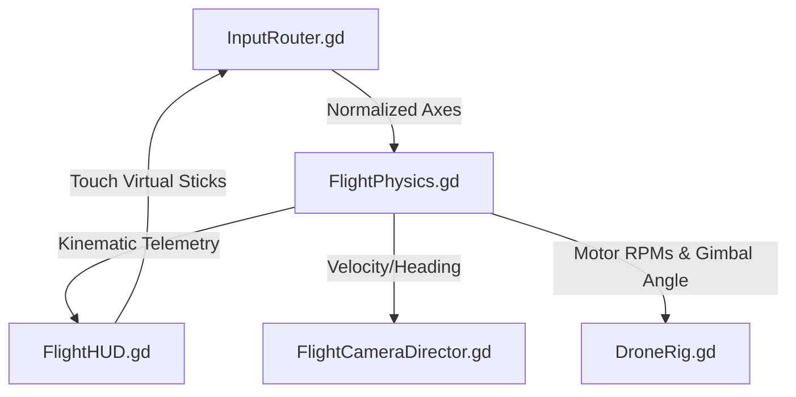

# Architecture Decision Record & Technical Architecture
## MindSparQ Drone Simulator — Phase 1

### 1. Engine & Runtime Selection
- **Decision:** Godot 4.3 Stable (Forward+ renderer for desktop, Mobile export ready).
- **Rationale:** Lightweight footprint (~50MB engine), zero runtime royalties, open-source C++ core, deterministic 60Hz physics tick, native 3D scene tree and cross-platform export without third-party vendor lock-in.

### 2. Separation of Concerns

- **`InputRouter.gd`**: Normalizes inputs across physical keyboard, USB gamepads, and virtual on-screen analog sticks into four normalized floating-point channels (`throttle`, `yaw`, `pitch`, `roll`) with deadzones and cubic expo curves.
- **`FlightPhysics.gd`**: A deterministic fixed-timestep (`_physics_process`) simulation that acts directly on the quadcopter's `RigidBody3D`. It calculates individual motor thrusts, applies PID auto-leveling torque, models ground-effect cushioning at altitudes $< 1.5\text{ m}$, aerodynamic drag, and realistic battery consumption under motor load.
- **`DroneRig.gd`**: Isolates visual presentation from rigid body physics. Drives rotational speeds of 4 independent rotor meshes with counter-rotating pairs, navigation LEDs, and stabilizes the camera gimbal on the pitch axis.
- **`FlightCameraDirector.gd`**: Multi-camera director managing Chase, FPV (gimbal lens), Orbit, and Top-Down modes with position damping and velocity look-ahead.
- **`VirtualJoystick.gd` & `FlightHUD.gd`**: Twin virtual analog stick UI with spring-return and dynamic telemetry visualization (Speed, Altitude AGL, Vertical Speed, Heading, Voltage, Battery %, Flight Mode).
