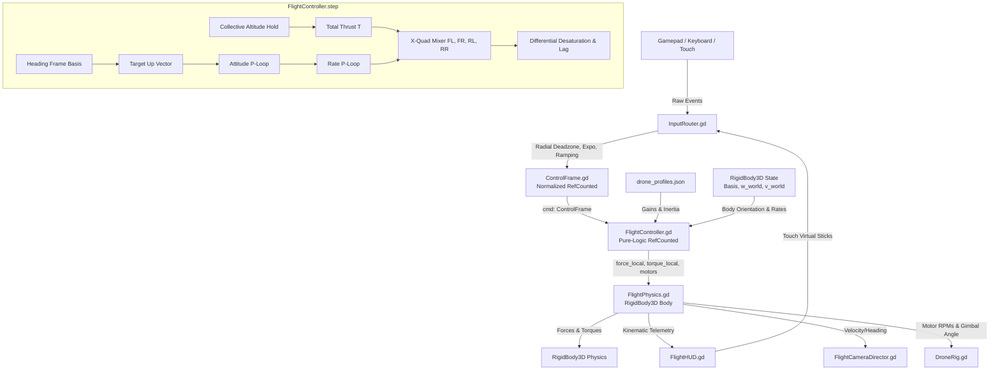

# Architecture Decision Record & Technical Architecture
## MindSparQ Drone Simulator

### 1. Engine & Runtime Selection
- **Decision:** Godot 4.3 Stable (Forward+ renderer for desktop, Mobile export ready).
- **Physics Ticks:** 120 Hz fixed physics step with `max_physics_steps_per_frame = 8` for deterministic flight dynamics and aerobatic stunt maneuvers.
- **Rationale:** Lightweight footprint, zero runtime royalties, open-source C++ core, deterministic physics tick, native 3D scene tree and cross-platform export without third-party vendor lock-in.

---

### 2. Separation of Concerns & Dataflow (Phase 3)

- **`ControlFrame.gd` (RefCounted)**: Unified data contract holding normalized axes in `[-1.0, 1.0]`: `throttle` (climb/descend), `yaw` (yaw right/left), `pitch` (forward/backward), `roll` (right/left).
- **`InputRouter.gd`**: Normalizes inputs across physical keyboard, USB gamepads, and virtual on-screen analog sticks into `ControlFrame` using circular radial deadzone (`0.12`), cubic expo (`0.35`), and keyboard attack/release ramping.
- **`FlightController.gd` (Pure Logic RefCounted)**:
  - **Zero scene-tree/node access**: strictly computational.
  - **Attitude Control**: Evaluates desired body-up orientation in the heading frame. Calculates attitude error vector $\mathbf{e} = \text{body}^T (\mathbf{u} \times \mathbf{u}_{\text{desired}})$, maps to rate target via $k_{p,\text{att}}$, and drives torque via angular rate P-loop with inertia tensor.
  - **Collective & Altitude Hold**: Translates throttle command to target climb rate, maintaining altitude hold when centered. Compares against vertical velocity with tilt compensation: $T = m(g + k_{p,\text{climb}}(v_{z,\text{cmd}} - v_y)) / \max(u_y, 0.5)$.
  - **X-Quad Mixer**: Maps total thrust $T$ and 3 torques $(\tau_x, \tau_y, \tau_z)$ to 4 motors $[0: FL, 1: FR, 2: RL, 3: RR]$. Employs equal shifting desaturation when $\max(f_i) > f_{\max}$ to preserve differential torque authority without control clipping. Models motor electrical/mechanical lag with first-order filter ($\tau = 0.04\text{s}$).
- **`FlightPhysics.gd`**: RigidBody3D integration node. Receives physical forces and torques from `FlightController`, manages high-level state machine (Takeoff, Hover, Flying, Landing, RTH, Disarmed, Crashed), battery drain, and flight geofencing.
- **`DroneRig.gd`**: Visual presentation. Animates 4 rotor meshes with counter-rotating pairs, navigation LEDs, and stabilizes the camera gimbal mount.
- **`FlightCameraDirector.gd`**: Multi-camera director managing Chase, FPV Gimbal, Orbit, and Top-Down modes with position damping and velocity look-ahead.

---

### 3. Coordinate System & Sign Conventions

Following standard Godot 3D conventions:
- **Axes**: Forward = $-Z$, Up = $+Y$, Right = $+X$.
- **Pitch**:
  - Pitch Up (nose up, towards $+Z$): Positive rotation about $+X$.
  - Pitch Forward (nose down, towards $-Z$): Negative rotation about $+X$. Rear motors ($RL, RR$) push harder than front motors ($FL, FR$).
- **Roll**:
  - Bank Left: Positive rotation about $-Z$ / positive torque about $+Z$.
  - Bank Right: Negative torque about $+Z$. Left motors ($FL, RL$) push harder than right motors ($FR, RR$).
- **Yaw**:
  - Positive rotation about $+Y$: Counter-clockwise from above (Yaw Left).
  - Negative rotation about $+Y$: Clockwise from above (Yaw Right). Counter-rotating motors ($FR, RL$ CCW) spin faster, imparting clockwise reaction torque.
- **Motor Index Mapping**:
  - `0`: Front Left (`FL`, $x = -d, z = -d$, CW)
  - `1`: Front Right (`FR`, $x = +d, z = -d$, CCW)
  - `2`: Rear Left (`RL`, $x = -d, z = +d$, CCW)
  - `3`: Rear Right (`RR`, $x = +d, z = +d$, CW)
