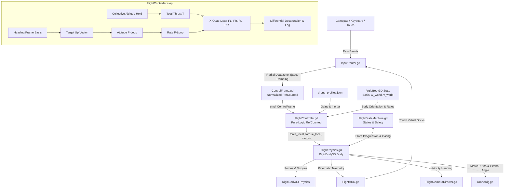
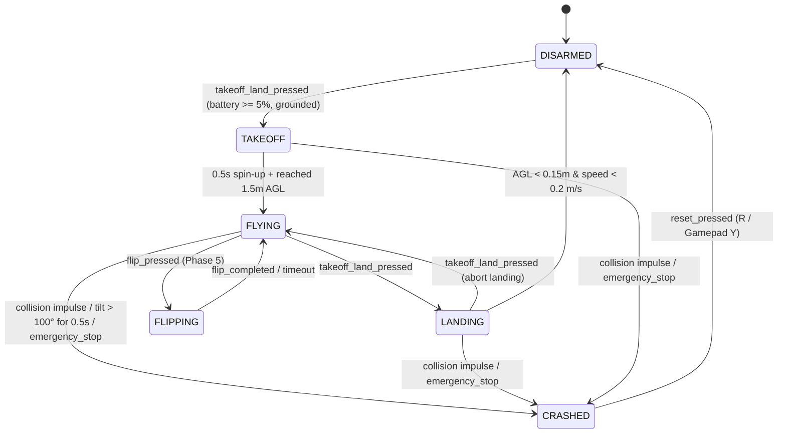
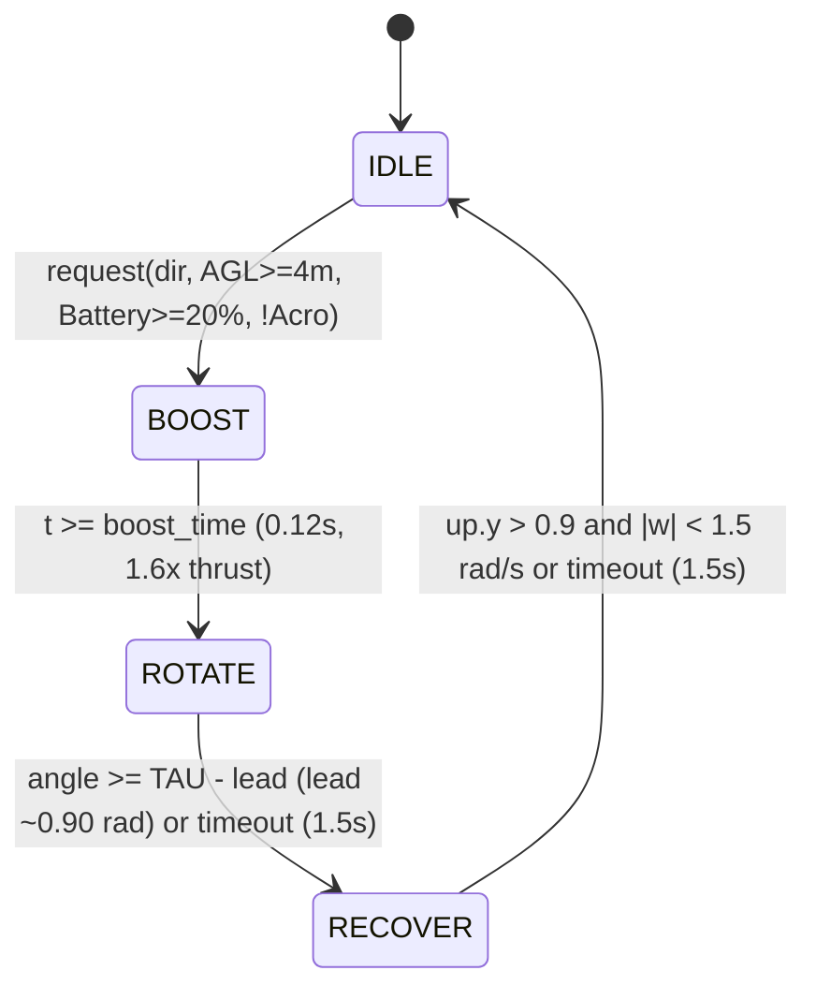
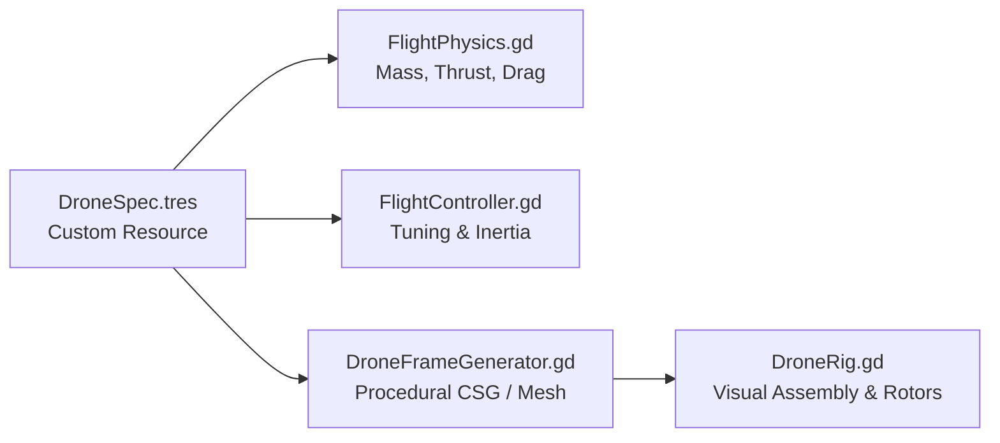
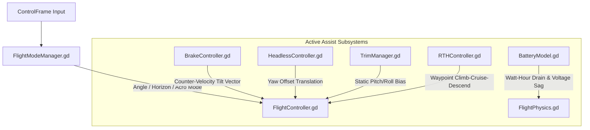
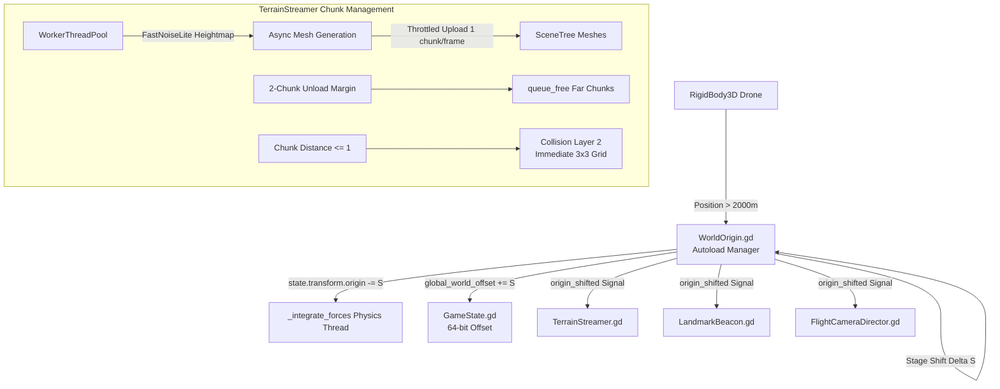

# Architecture Decision Record & Technical Architecture
## MindSparQ Drone Simulator

### 1. Engine & Runtime Selection
- **Decision:** Godot 4.3 Stable (Forward+ renderer for desktop, Mobile export ready).
- **Physics Ticks:** 120 Hz fixed physics step with `max_physics_steps_per_frame = 8` for deterministic flight dynamics and aerobatic stunt maneuvers.
- **Rationale:** Lightweight footprint, zero runtime royalties, open-source C++ core, deterministic physics tick, native 3D scene tree and cross-platform export without third-party vendor lock-in.

---

### 2. Separation of Concerns & Dataflow (Phase 3 & 4)

- **`ControlFrame.gd` (RefCounted)**: Unified data contract holding normalized axes in `[-1.0, 1.0]`: `throttle` (climb/descend), `yaw` (yaw right/left), `pitch` (forward/backward), `roll` (right/left).
- **`InputRouter.gd`**: Normalizes inputs across physical keyboard, USB gamepads, and virtual on-screen analog sticks into `ControlFrame` using circular radial deadzone (`0.12`), cubic expo (`0.35`), and keyboard attack/release ramping.
- **`FlightController.gd` (Pure Logic RefCounted)**:
  - **Zero scene-tree/node access**: strictly computational.
  - **Attitude Control**: Evaluates desired body-up orientation in the heading frame. Calculates attitude error vector $\mathbf{e} = \text{body}^T (\mathbf{u} \times \mathbf{u}_{\text{desired}})$, maps to rate target via $k_{p,\text{att}}$, and drives torque via angular rate P-loop with inertia tensor.
  - **Collective & Altitude Hold**: Translates throttle command to target climb rate, maintaining altitude hold when centered. Compares against vertical velocity with tilt compensation: $T = m(g + k_{p,\text{climb}}(v_{z,\text{cmd}} - v_y)) / \max(u_y, 0.5)$.
  - **X-Quad Mixer**: Maps total thrust $T$ and 3 torques $(\tau_x, \tau_y, \tau_z)$ to 4 motors $[0: FL, 1: FR, 2: RL, 3: RR]$. Employs equal shifting desaturation when $\max(f_i) > f_{\max}$ to preserve differential torque authority without control clipping. Models motor electrical/mechanical lag with first-order filter ($\tau = 0.04\text{s}$).
- **`FlightStateMachine.gd` (Pure Logic RefCounted)**: Standalone state machine managing 6 states (`DISARMED`, `TAKEOFF`, `FLYING`, `LANDING`, `FLIPPING`, `CRASHED`), spin-up timers, landing descent, touchdown detection, tilt inversion safety, and emergency disarm.
- **`FlightPhysics.gd`**: RigidBody3D integration node. Receives physical forces and torques from `FlightController`, synchronizes state with `FlightStateMachine`, executes downward raycast queries on `PhysicsDirectSpaceState3D` every physics tick, and emits telemetry.
- **`DroneRig.gd`**: Visual presentation. Animates 4 rotor meshes with counter-rotating pairs, navigation LEDs, and stabilizes the camera gimbal mount.
- **`FlightCameraDirector.gd`**: Multi-camera director managing Chase, FPV Gimbal, Orbit, and Top-Down modes with position damping and velocity look-ahead.

---

### 3. Coordinate System & Sign Conventions

Following standard Godot 3D conventions:
- **Axes**: Forward = $-Z$, Up = $+Y$, Right = $+X$.
- **Pitch**:
  - Pitch Up (nose up, towards $+Z$): Positive rotation about $+X$.
  - Pitch Forward (nose down, towards $-Z$): Negative rotation about $+X$. Rear motors ($RL, RR$) push harder than front motors ($FL, FR$).
- **Roll**:
  - Bank Left: Positive rotation about $-Z$ / positive torque about $+Z$.
  - Bank Right: Negative torque about $+Z$. Left motors ($FL, RL$) push harder than right motors ($FR, RR$).
- **Yaw**:
  - Positive rotation about $+Y$: Counter-clockwise from above (Yaw Left).
  - Negative rotation about $+Y$: Clockwise from above (Yaw Right). Counter-rotating motors ($FR, RL$ CCW) spin faster, imparting clockwise reaction torque.
- **Motor Index Mapping**:
  - `0`: Front Left (`FL`, $x = -d, z = -d$, CW)
  - `1`: Front Right (`FR`, $x = +d, z = -d$, CCW)
  - `2`: Rear Left (`RL`, $x = -d, z = +d$, CCW)
  - `3`: Rear Right (`RR`, $x = +d, z = +d$, CW)

---

### 4. State Machine & Safety Transition Matrix (Phase 4)

| Current State | Event / Trigger | Target State | Guards & Execution Logic |
|---|---|---|---|
| `DISARMED` | `takeoff_land` | `TAKEOFF` | Battery $\ge 5\%$, grounded on launch pad. Starts 0.5s spin-up. |
| `TAKEOFF` | Target reached | `FLYING` | $t \ge 0.5\text{s}$ and $\text{AGL} \ge 1.5\text{m}$. Enables manual control. |
| `TAKEOFF` | `emergency_stop` | `CRASHED` | Held 0.7s. Zeroes all motor thrust within 1 tick. |
| `FLYING` | `takeoff_land` | `LANDING` | Initiates controlled $0.8\text{ m/s}$ vertical descent with horizontal braking. |
| `LANDING` | `takeoff_land` | `FLYING` | Aborts landing; pilot regains full attitude authority immediately. |
| `LANDING` | Touchdown | `DISARMED` | Triggered when $\text{AGL} \le 0.15\text{m}$ and ground speed $\le 0.2\text{ m/s}$. Disarms motors. |
| `FLYING` | `emergency_stop`| `CRASHED` | Held 0.7s. Instantly cuts motor thrust to 0.0 N. |
| `ANY AIRBORNE` | Inversion Tilt | `CRASHED` | Body tilt $> 100^\circ$ sustained for $> 0.5\text{s}$ at altitude $\le 5.0\text{m}$. |
| `ANY AIRBORNE` | Impact | `CRASHED` | Collision impulse $\ge 12.0\text{ N/kg}$. |
| `CRASHED` | `reset` | `DISARMED` | Overloaded Space recover removed; strictly requires Reset (`R` / Gamepad `Y`). |

---

### 5. Aerobatic Flip System (`FlipController.gd`, Phase 5)

- **Architecture**: `FlipController` is a pure-logic `RefCounted` class with zero node/scene tree access.
- **Preconditions**:
  - State must be `FLYING` (`state_machine.is_flying()`).
  - Altitude must be $\ge 4.0\text{ m AGL}$ to prevent ground strikes.
  - Battery capacity must be $\ge 20\%$ (`battery >= 0.20`).
  - Active profile must NOT be `acro` (manual rate pilots execute unassisted flips).
  - No concurrent flip already active (`phase == Phase.IDLE`).
- **4-Way Cardinal Axes in Godot 3D Coordinate Space**:
  - **Front Flip** (`dir.y > 0`): Negative X (`Vector3(-1, 0, 0)`) — nose down pitch rotation.
  - **Back Flip** (`dir.y <= 0`): Positive X (`Vector3(1, 0, 0)`) — nose up pitch rotation. Stick centered defaults to back flip.
  - **Left Roll** (`dir.x < 0`): Positive Z (`Vector3(0, 0, 1)`) — bank left roll rotation.
  - **Right Roll** (`dir.x > 0`): Negative Z (`Vector3(0, 0, -1)`) — bank right roll rotation.
- **Phase Execution & Thrust Management**:
  - `BOOST`: 0.12s vertical upward impulse at $1.6\times$ hover thrust to build positive vertical momentum before roll inversion.
  - `ROTATE`: Commands target angular velocity $\mathbf{\omega}_{\text{target}} = \text{axis}_{\text{local}} \cdot 720^\circ/\text{s}$. **Thrust is cut to $0.0\times$ whenever inverted ($u_y < 0.0$)**, completely preventing inverted motor thrust from driving the drone downward. Accumulates rotated angle $\int |\mathbf{\omega} \cdot \mathbf{n}| dt$ and exits at $\tau - \text{lead}$ ($\approx 308.5^\circ$ with lead $= 0.90\text{ rad}$).
  - `RECOVER`: Returns control authority to `FlightController` angle-mode auto-leveling at $1.2\times$ thrust. Transitions cleanly to `IDLE` when upright ($u_y > 0.90$) and settled ($|\mathbf{\omega}| < 1.5\text{ rad/s}$).
  - `SAFETY TIMEOUT`: 1.5s per-phase timeout safely hands control back to normal angle mode without forcing a crash.
- **Flight State & Stick Isolation**:
  - During flip execution, `FlightStateMachine` enters `State.FLIPPING`.
  - Manual pitch, roll, and yaw stick commands are isolated to prevent pilot interference mid-rotation.
  - Inverted tilt crash detection is bypassed during `State.FLIPPING`.

---

### 6. DroneSpec Resource & Procedural Frame Architecture (Phase 6)

- **Single Source of Truth (`DroneSpec.gd`)**:
  - A custom `Resource` encapsulating mass ($kg$), arm length / wheelbase ($m$), motor KV rating, propeller diameter/pitch, battery cell count ($S$), maximum thrust per motor ($N$), aerodynamic drag coefficients, and estimated diagonal inertia tensor matrix:
    $$I_{xx} = m \cdot \left(\frac{d^2}{4} + \frac{h^2}{12}\right), \quad I_{yy} = m \cdot \frac{d^2}{2}, \quad I_{zz} = I_{xx}$$
- **3 Production Presets**:
  1. `scout_spec.tres`: 0.85 kg, 220 mm wheelbase, 4S LiPo, balanced TWR 2.2, all-around reconnaissance.
  2. `photo_spec.tres`: 1.45 kg, 330 mm wheelbase, 4S LiPo, 3-axis stabilized camera gimbal, heavy damping for cinematic aerial filming.
  3. `racer_spec.tres`: 0.55 kg, 180 mm wheelbase, 6S LiPo, extreme TWR > 3.5, high angular rate authority for competitive FPV racing.
- **Procedural Frame Generator (`DroneFrameGenerator.gd`)**:
  - Generates full visual airframes procedurally using Godot primitives (CSG / ArrayMesh) with matte carbon-fiber materials, anodized aluminum standoffs, motor bells, propeller blades, and tinted camera canopy—eliminating external 3D asset dependencies.

---

### 7. Advanced Flight Control Modules (Phase 7)

- **`FlightModeManager.gd`**:
  - **ANGLE (Mode 1)**: Self-leveling mode with tilt clamped to profile maximum (e.g. 28° in Normal). Stick release snaps drone upright.
  - **HORIZON (Mode 2)**: Hybrid assisted mode with a 70% deflection deadband. Within 0% to 70% stick deflection, self-levels like Angle mode; beyond 70%, transitions smoothly into rate-controlled continuous rolls/flips.
  - **ACRO (Mode 3)**: Pure gyroscopic angular rate control ($^\circ/\text{s}$). Zero auto-leveling. Directly controls angular velocities for inverted flying and manual aerobatics.
- **`BrakeController.gd`**:
  - Triggered by holding the Brake key (`B` / Gamepad `LB`). Computes the inverse horizontal velocity unit vector $\hat{\mathbf{v}}_{\text{opp}} = -(\mathbf{v}_{xz} / |\mathbf{v}_{xz}|)$ and commands an aggressive counter-tilt until ground speed drops below $0.15\text{ m/s}$, stabilizing the quadcopter into stationary hover.
- **`HeadlessController.gd`**:
  - Decouples pilot control stick orientation from current drone yaw. Records launch yaw heading $\psi_0$ on takeoff. Projects pilot pitch and roll input along the launch frame:
    $$\begin{bmatrix} \text{pitch}_{\text{body}} \\ \text{roll}_{\text{body}} \end{bmatrix} = \mathbf{R}(\psi - \psi_0) \begin{bmatrix} \text{pitch}_{\text{input}} \\ \text{roll}_{\text{input}} \end{bmatrix}$$
- **`TrimManager.gd`**:
  - Provides digital mechanical trim adjustment for pitch and roll ($\pm 10^\circ$ range in $0.5^\circ$ increments) to compensate for aerodynamic drag imbalances or payload offsets, persisted in `SettingsService`.
- **`BatteryModel.gd`**:
  - Models 4S LiPo battery discharge dynamics using electrical watt-hour accumulation:
    $$P_{\text{total}} = P_{\text{avionics}} + \sum_{i=1}^4 c_{\text{motor}} \cdot (\text{RPM}_i)^3$$
  - Simulates internal resistance voltage sag under boost thrust; triggers low battery warning at 20% and failsafe Return-To-Home at 10%.
- **`RTHController.gd`**:
  - 3-Phase automated failsafe:
    1. **CLIMB**: Rises vertically to safe clearance cruise altitude ($\max(\text{AGL}_{\text{current}}, 15\text{m})$).
    2. **CRUISE**: Translates toward launch pad at $8.0\text{ m/s}$ with proportional bearing alignment.
    3. **DESCEND**: When within 1.5m horizontal radius of home, descends at $0.8\text{ m/s}$ and auto-disarms on touchdown.

---

### 8. Vector HUD & Dynamic Settings Architecture (Phase 8)

- **Vector Canvas Rendering**:
  - HUD components inherit from `Control` and draw vector elements procedurally via `_draw()` without raster texture filtering or resolution blur.
- **`ArtificialHorizon.gd`**:
  - Pitch ladder with 10° rung markings, moving roll arc with pointer, and center water-line aircraft reticle. Roll angle normalization utilizes `posmod` to guarantee smooth, seamless transitions across $\pm 180^\circ$ inversions.
- **`HeadingStrip.gd`**:
  - Horizontal scrolling compass tape spanning top of the HUD. Shows 0°–360° heading degrees with cardinal abbreviations (`N`, `NE`, `E`, `SE`, `S`, `SW`, `W`, `NW`).
- **`HomeArrow.gd`**:
  - Vector arrow rotating toward the projected 2D bearing of the launch home pad, computing heading-relative angle $\theta_{\text{home}} = \text{atan2}(z_{\text{rel}}, x_{\text{rel}}) - \psi_{\text{drone}}$.
- **`SettingsService.gd` & `PauseMenu.gd`**:
  - Autoload singleton managing cubic expo sliders, deadzone thresholds, camera FOV ($60^\circ \dots 105^\circ$), metric/imperial telemetry display ($m/s \leftrightarrow mph$), and dynamic action rebinding with conflict detection.

---

### 9. Long-Distance World Streaming & Floating Origin Architecture (Phase 9)

- **Floating Origin (`WorldOrigin.gd`)**:
  - Solves 32-bit floating-point precision jitter when flying beyond 2,000 meters.
  - When $|\mathbf{p}_{\text{drone}}| > 2000\text{m}$, stages a grid-aligned shift vector $\mathbf{S}$.
  - **Thread-Safe RigidBody3D Repositioning**: Shift is applied directly to `state.transform.origin -= S` inside `_integrate_forces(state: PhysicsDirectBodyState3D)`, preserving `linear_velocity` and `angular_velocity` without solver impulse disruption.
  - Tracks true world coordinates in 64-bit float vectors: $\mathbf{P}_{\text{true}} = \mathbf{P}_{\text{local}} + \mathbf{O}_{\text{world}}$.
- **`TerrainStreamer.gd`**:
  - Generates continuous, procedural infinite terrain divided into 256m chunks using `FastNoiseLite`.
  - Multi-threaded asynchronous generation via Godot's `WorkerThreadPool`.
  - Two Level-of-Detail (LOD) tiers: LOD 0 ($32 \times 32$ quads) within 2 chunks of drone; LOD 1 ($16 \times 16$ quads) for outer chunks.
  - Upload budget throttled to 1 chunk per frame to eliminate main-thread stutter.
  - 2-chunk unload hysteresis to prevent boundary generation thrashing.
- **Selective Broadphase Physics Collision**:
  - Only chunks within distance $\le 1$ ($3 \times 3$ grid around drone) activate `collision_layer = 2`. Outer chunks have collision disabled (`collision_layer = 0`), reducing physics engine broadphase BVH overhead by over 80%.
- **`LandmarkBeacon.gd`**:
  - Glowing 40m navigation beacon towers instantiated every 1,000m along the world grid, providing visual horizon orientation up to 8,000m.
