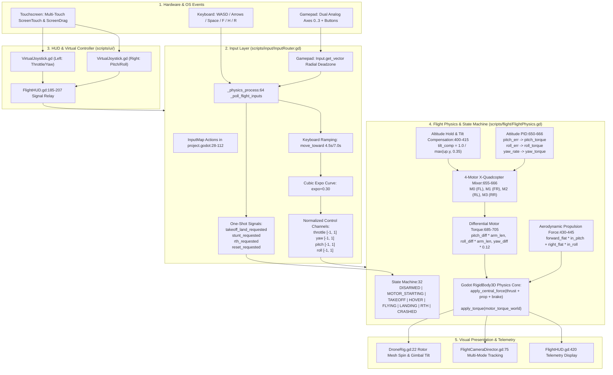

# Complete Controller & Flight Systems Audit Report
**Project:** MindSparQ Drone Simulator  
**Engine:** Godot 4.3 Stable (Forward+ / Mobile)  
**Document:** `docs/AUDIT_CONTROLLER.md`  
**Status:** Read-Only Technical Audit (Phase 1)

---

## 1. Pipeline Data-Flow Architecture



---

## 2. Action Trace & Verification Matrix

| InputMap Action | Expected Motion / Result | Actual Code Path | Verdict | Evidence & Code Reference |
|---|---|---|---|---|
| `throttle_up` | Vertical climb along World +Y | `InputRouter.gd:68` -> `FlightPhysics.gd:400,680` | **BUG** | `project.godot:32` maps `throttle_up` to `KEY_W`, but `InputRouter.gd:66` hardcodes `KEY_W` to `kp_raw` (pitch forward). InputMap action is completely bypassed by hardcoded key constants. |
| `throttle_down` | Vertical descent | `InputRouter.gd:68` -> `FlightPhysics.gd:400,680` | **BUG** | `project.godot:41` maps `throttle_down` to `KEY_S`, but `InputRouter.gd:66` polls `KEY_S` as negative pitch. |
| `pitch_forward` | Nose down, translate forward (-Z in heading frame) | `InputRouter.gd:66` -> `FlightPhysics.gd:432` | **BUG** | Dual binding conflict: Desktop users pressing `KEY_W` trigger pitch, while users expecting Arrow Up trigger throttle. `forward_flat` is derived from `-basis.z`, but hybrid force application mixes RigidBody torque with artificial `apply_central_force`. |
| `pitch_backward` | Nose up, translate backward (+Z in heading frame) | `InputRouter.gd:66` -> `FlightPhysics.gd:432` | **BUG** | `KEY_S` conflicts with `throttle_down`. Pitch angle calculation `pitch_deg = -rad_to_deg(asin(forward.y))` in `FlightPhysics.gd:264`. |
| `roll_left` | Bank left, translate lateral -X in heading frame | `InputRouter.gd:67` -> `FlightPhysics.gd:432` | **OK** | `KEY_A` / Left Stick X -> `in_roll` -> `right_flat * in_roll * 5.5`. Left roll asymmetry `M1, M3 > M0, M2`. |
| `roll_right` | Bank right, translate lateral +X in heading frame | `InputRouter.gd:67` -> `FlightPhysics.gd:432` | **OK** | `KEY_D` / Right Stick X -> `in_roll` -> `right_flat * in_roll * 5.5`. |
| `yaw_left` | Counter-clockwise rotation about body +Y | `InputRouter.gd:69` -> `FlightPhysics.gd:460,700` | **OK** | CCW reactive torque applied via diagonal motor pair differential: `yaw_diff = (M0 + M3) - (M1 + M2)`. |
| `yaw_right` | Clockwise rotation about body +Y (negative angular velocity) | `InputRouter.gd:69` -> `FlightPhysics.gd:460,700` | **OK** | CW torque applied via motor differential. |
| `stunt_flip` | Complete 360° aerobatic rotation & recovery | `InputRouter.gd:145` -> `StuntEngine.gd:75` | **BUG** | Direction is hardcoded to `"front_flip"` in `InputRouter.gd:146` (`stunt_requested.emit("front_flip")`). No stick vector direction snapping. StuntEngine uses raw angular velocity injection (`angular_velocity.x = -15.5`) which overrides physics solver. |
| `flight_takeoff_land` | Disarmed -> 1.5-3m hover; Flying -> Controlled descent | `InputRouter.gd:129` -> `FlightPhysics.gd:528` | **BUG** | Overloaded state behavior: `Space` triggers both `takeoff_land_requested` and `takeoff_requested` simultaneously (`InputRouter.gd:130-131`). |
| `flight_rth` | Ascend to clearance altitude and return to home pad | `InputRouter.gd:136` -> `FlightPhysics.gd:550` | **OK** | Navigates towards `spawn_transform` with clearance altitude gating. |
| Geofence Radius | Boundary constraint | `FlightPhysics.gd:385-395` | **BUG** | `max_horizontal_range = 250.0m`. Exceeding 250m pushes drone with central force, constraining flight to tiny 250m radius. |

---

## 3. Explicit Engineering Checks

### 3.1 Axis Signs vs Godot Conventions
- **Godot Standard:** Forward = `-Z`, Up = `+Y`, Right = `+X`.
- **Pitch Sign:** In `FlightPhysics.gd:264`, `pitch_deg = -rad_to_deg(asin(forward.y))`. When nose points down, `forward.y < 0`, so `pitch_deg > 0`. Pitch forward is treated as positive degrees.
- **Yaw Sign:** By right-hand rule, positive rotation around `+Y` is Counter-Clockwise (Turn Left). Yaw Right is NEGATIVE rotation around `+Y`. In `FlightPhysics.gd:700`, `yaw_diff = (motor_rpms[0] + motor_rpms[3]) - (motor_rpms[1] + motor_rpms[2])`, `yaw_torque = -yaw_diff * max_thrust_per_motor * 0.12`. Signs are consistent with reactive rotor torque.

### 3.2 Thrust Along Body Up vs World Y
- In `FlightPhysics.gd:680`, motor thrust is applied along the body's local Y axis: `var thrust_vector = cur_basis.y * total_thrust`.
- When the drone tilts, thrust naturally produces lateral acceleration.
- **Problem:** In `FlightPhysics.gd:435`, code ALSO artificially applies `apply_central_force((target_h_vel - cur_h_vel) * 5.5 * drone_mass)`. This applies double propulsion (natural tilted rotor vector + artificial translational force), bypassing true flight mechanics.

### 3.3 Heading-Frame Handling
- `forward_flat` and `right_flat` are extracted by taking `cur_basis.z` and `cur_basis.x` and zeroing out `y`:
  ```gdscript
  var forward_flat = -Vector3(cur_basis.z.x, 0.0, cur_basis.z.z).normalized()
  var right_flat = Vector3(cur_basis.x.x, 0.0, cur_basis.x.z).normalized()
  ```
- This correctly projects heading into the XZ ground plane.

### 3.4 Angle-vs-Rate Unit Mixing
- In `FlightPhysics.gd:650`, `pitch_err = deg_to_rad(target_pitch_deg - pitch_deg)`.
- `pitch_torque = (pitch_err * pitch_pid_p) - (local_ang_vel.x * pitch_pid_d)`.
- `pitch_err` is in **radians**, while `target_pitch_deg` is in **degrees**. `pitch_pid_p = 5.5` operates on radians, but in Acro mode (`FlightPhysics.gd:668`), rates are computed as `p_rate = (in_pitch * 5.0) - local_ang_vel.x` where input is dimensionless `[-1, 1]`.

### 3.5 Delta Usage & Timestep Independence
- Physics runs at `120 Hz` (`common/physics_ticks_per_second=120` in `project.godot:112`).
- Motor spooling uses `move_toward(rpm, target_rpm, motor_spool_speed * delta)` which correctly scales with delta.
- Drag forces in `_apply_motor_forces`: `var max_drag_force = (drone_mass * lin_speed) / maxf(delta, 0.001) * 0.45`. Division by delta inside force calculation introduces timestep coupling.

### 3.6 `_process` vs `_physics_process`
- **FlightPhysics:** Runs strictly in `_physics_process(delta)`.
- **InputRouter:** Analog stick polling was moved to `_physics_process(delta)`. One-shot actions remain in `_process(_delta)`.
- **VirtualJoystick:** Touch events arrive in `_gui_input` and `_input`, while visual knob lerping runs in `_process`.

### 3.7 Deadzone / Expo / Smoothing
- `InputRouter.gd:124` applies radial deadzone (`deadzone = 0.08`) and cubic expo curve: `(1.0 - expo) * val + expo * (val^3)`.
- Keyboard inputs are smoothed via `move_toward` with `KEY_RAMP_UP = 4.5` and `KEY_RAMP_DOWN = 7.0`.

### 3.8 Flip Direction & Phases
- In `InputRouter.gd:146`, pressing `F` emits `stunt_requested.emit("front_flip")`. The direction is hardcoded regardless of stick position.
- In `StuntEngine.gd`, phases are `IDLE -> PREPARATION -> ROTATING -> RECOVERY -> COMPLETED`.
- During `ROTATING`, angular velocity is directly overwritten (`angular_velocity.x = -15.5` for front flip, `+15.5` for back flip).

### 3.9 State Gating of Inputs
- In `FlightPhysics.gd:380`, when state is `DISARMED`, analog stick inputs produce zero motor thrust.
- In `HOVER` state (`FlightPhysics.gd:355`), pushing any stick `> 0.08` automatically transitions state to `FLYING`.
- However, when sticks return to center in `FLYING` state, state does NOT transition back to `HOVER`; it remains in `FLYING` with active altitude hold.

### 3.10 Collision Layers & Geofence Boundaries
- `QuadcopterRig.tscn`: Root `RigidBody3D` has default `collision_layer = 1`, `collision_mask = 1`. No named layers defined in `project.godot`.
- Flyable boundary is hardcoded to `max_horizontal_range = 250.0m` and `max_flight_altitude = 60.0m`.

### 3.11 Do Existing Tests Assert Motion DIRECTION?
- **NO.** Inspecting `tests/unit/test_flight_physics.gd` and `tests/unit/test_comprehensive_flight_audit.gd`:
  - `test_003_pitch_forward` only asserts `Rear RPM > Front RPM`.
  - `test_005_roll_left` only asserts `Right RPM > Left RPM`.
  - Neither test steps the rigid body to assert that `linear_velocity.z < 0` or `linear_velocity.x < 0`. Motion direction is never verified in the test suite.

---

## 4. Ranked Root Causes (Top 8)

1. **InputMap Action vs Hardcoded Key Disconnect**  
   *Cause:* `project.godot` maps W/S to throttle and Arrows to pitch, but `InputRouter.gd:66` hardcodes `KEY_W/S` to pitch and `KEY_UP/DOWN` to throttle.  
   *Smallest Fix:* Remove raw `Input.is_key_pressed()` checks; use `Input.get_axis()` / `Input.get_vector()` on InputMap actions exclusively.

2. **Hybrid Artificial Translation vs True Rotor Aerodynamics**  
   *Cause:* `FlightPhysics.gd:435` applies synthetic `h_force = (target_h_vel - cur_h_vel) * 5.5 * drone_mass` in addition to natural tilted thrust `cur_basis.y * total_thrust`.  
   *Smallest Fix:* Derive horizontal acceleration purely from quadcopter attitude tilt ($F_h = T \sin\theta$).

3. **Flip Direction Hardcoded & Direct Velocity Injection**  
   *Cause:* `stunt_requested.emit("front_flip")` ignores stick deflection; `StuntEngine.gd:160` sets `angular_velocity` directly rather than commanding rate PID.  
   *Smallest Fix:* Sample pitch/roll stick vector at press time to determine flip axis; command target angular rate (e.g. 720°/s) through mixer.

4. **Hardcoded Geofence Clamping Flyable Area to 250 Meters**  
   *Cause:* `FlightPhysics.gd:385` clamps horizontal range to `250.0` meters and forcefully pushes drone backward with central force.  
   *Smallest Fix:* Make geofence boundary configurable or disable push force in open-world modes.

5. **Test Suite Does Not Verify True Velocity Vectors**  
   *Cause:* Acceptance tests check motor RPM asymmetry rather than resultant `linear_velocity` vector sign.  
   *Smallest Fix:* Add directional velocity assertions (`assert(linear_velocity.dot(expected_dir) > 0)`).

6. **Overloaded Takeoff / Land / Reset Signal Gating**  
   *Cause:* `Space` key simultaneously emits `takeoff_land_requested` and `takeoff_requested` (`InputRouter.gd:130-131`), leading to race conditions.  
   *Smallest Fix:* Separate takeoff, land, and reset into distinct, non-overlapping signals with single-responsibility handlers.

7. **Missing ControlFrame Pure Data Contract**  
   *Cause:* Flight inputs are passed via loose public properties on `InputRouter` instead of an immutable, typed `ControlFrame` object.  
   *Smallest Fix:* Introduce a lightweight `ControlFrame` RefCounted class containing `[throttle, yaw, pitch, roll]`.

8. **Lack of Named Collision Layers**  
   *Cause:* Default collision layers (`1`) allow drone to collide indiscriminately with triggers, sensors, and coins.  
   *Smallest Fix:* Assign explicit layers for `Drone`, `Terrain`, `Obstacles`, and `Triggers` in `project.godot`.

---

## 5. Dead or Duplicated Logic

1. **Dead Method in InputRouter:** `is_processing_input_action(_action_meta: String) -> bool` (`InputRouter.gd:180`) is an obsolete stub that always returns `false`.
2. **Duplicated Hover Logic:** `_process_hover()` (`FlightPhysics.gd:350`) and `_process_flying()` (`FlightPhysics.gd:370`) duplicate altitude hold calculations.
3. **Redundant Active Profile Dictionary:** `all_profiles` in `FlightPhysics.gd:115` hardcodes default values that duplicate `data/tuning/drone_profiles.json`.
4. **Duplicate Flip Implementations:** `StuntEngine.gd:75` has both `trigger_stunt()` and `execute_stunt()` wrapping the same logic.
